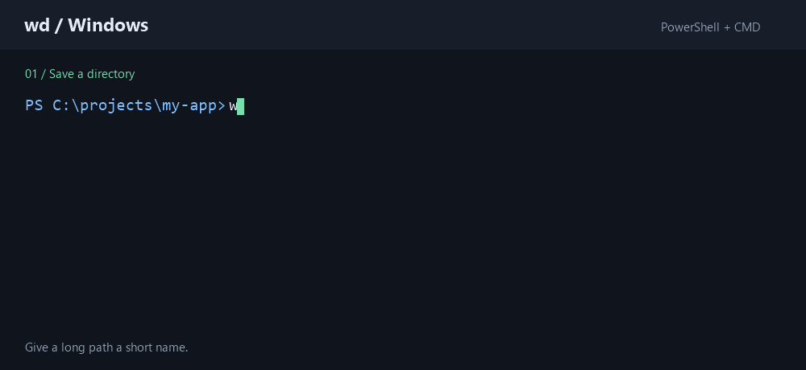

# wd for Windows

`wd` (warp directory) bookmarks directories you use often and lets you jump to them by name from PowerShell or Command Prompt.



```text
PS C:\projects\some-long-project-name> wd add project
PS C:\projects\some-long-project-name> cd C:\Windows
PS C:\Windows> wd project
PS C:\projects\some-long-project-name>
```

It follows the command model of the [`wd` plugin for Oh My Zsh](https://github.com/mfaerevaag/wd) by Markus Færevaag and understands Windows drive-letter paths. This is an independent Windows implementation, not an official Oh My Zsh project or an endorsed upstream release.

## Features

- **Jump by name** — `wd work` from anywhere, in PowerShell or Command Prompt.
- **One bookmark file** shared by both shells, at `%USERPROFILE%\.warprc`.
- **Go deeper in one step** — `wd work src` lands in the `src` directory inside the bookmark.
- **List, inspect, open** — `wd list`, `wd show`, `wd path`, `wd ls`, `wd open`.
- **Self-cleaning** — `wd clean` drops bookmarks whose directories are gone.
- **Self-contained executable**, so no .NET runtime is needed once installed.

## Install

Download the ZIP from the [releases page](https://github.com/alexlvcom/wd/releases/latest), extract it, and run:

```powershell
powershell -ExecutionPolicy Bypass -File .\scripts\Install.ps1 -SkipBuild
```

That needs neither Git nor the .NET SDK. Keep the full archive contents together, including the license notices.

Close and reopen your terminal, then check it with `wd --version`.

To install from source instead, or for what the installer changes and how to update later, see [Installing](docs/GUIDE.md#installing).

## License and attribution

The Windows implementation is available under the [MIT license](LICENSE). The original plugin's copyright and MIT permission notice are preserved in [THIRD-PARTY-NOTICES.md](THIRD-PARTY-NOTICES.md). MIT permits use, modification, redistribution, and commercial use subject to its notice requirements.

## Documentation

- **[User guide](docs/GUIDE.md)** — installing, every command, the bookmark file, and troubleshooting.
- **[Development](docs/DEVELOPMENT.md)** — building, testing, packaging and the project layout.
